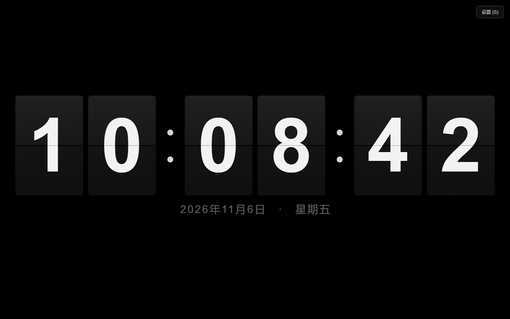
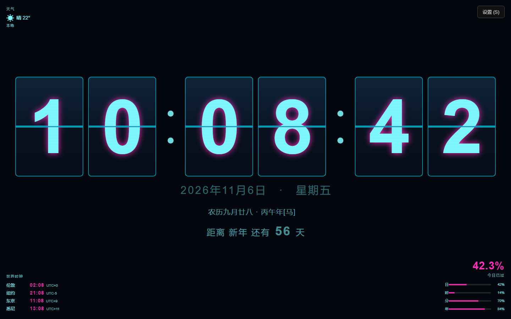
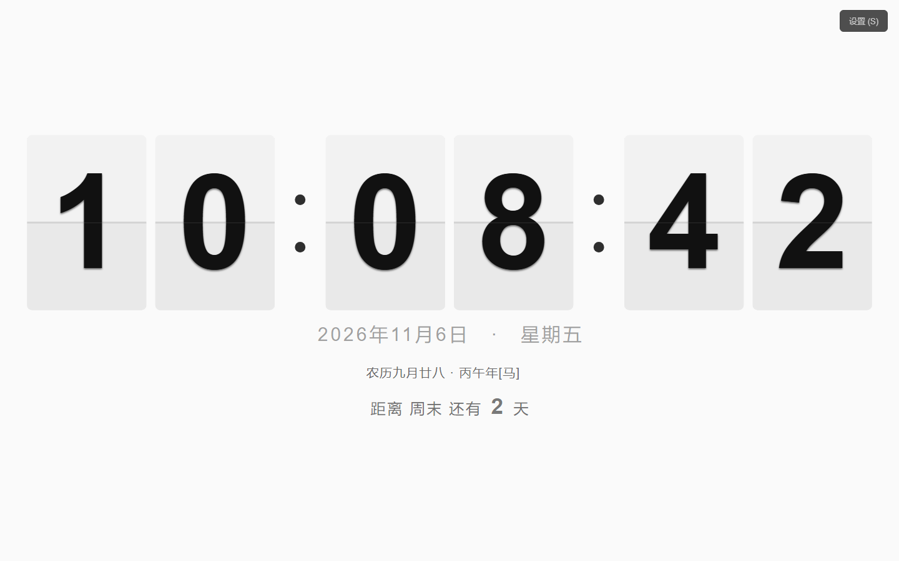
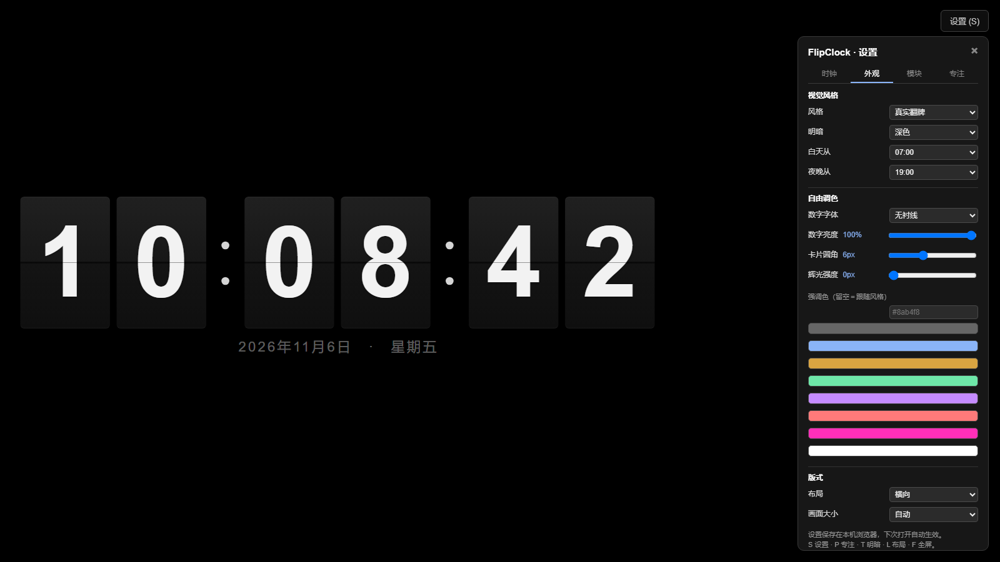
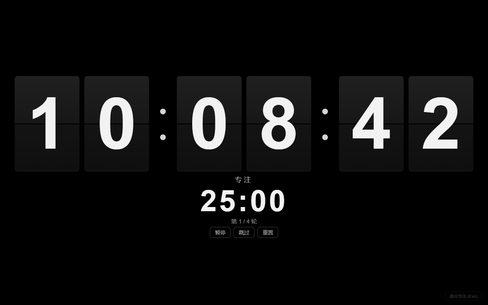
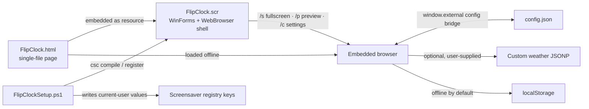
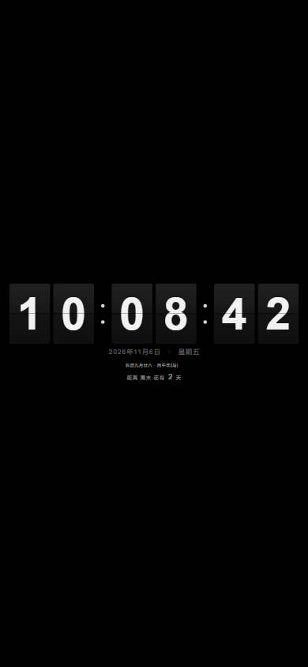

  

<h1 align="center">FlipClock</h1>

  <strong>A fully offline flip clock</strong> 
  One HTML file · installable as a Windows screensaver · no network, no dependencies

  <b>English</b> · <a href="README.md">简体中文</a> &nbsp;|&nbsp;
  <a href="#screenshots">Screenshots</a> ·
  <a href="#quick-start">Quick start</a> ·
  <a href="#install-as-a-screensaver">Install screensaver</a> ·
  <a href="https://github.com/xyzOvO/FlipClock/issues">Issues</a>

---

> *My favourite screensaver from college stopped working after a system update and only showed a black screen. In the age of AI I rebuilt it from scratch — hope it helps anyone who needs it.*
>
> Translated from the original Chinese note in [README.md](README.md).

<table>
<tr><td valign="top">

- [Screenshots](#screenshots)
- [Quick start](#quick-start)
- [Features](#features)
- [Settings & shortcuts](#settings--shortcuts)
- [Modules](#modules)
- [Install as a screensaver](#install-as-a-screensaver)
- [Background](#background)

</td><td valign="top">

- [How it works](#how-it-works)
- [Files](#files)
- [Compatibility](#compatibility)
- [FAQ](#faq)
- [Known limits](#known-limits)
- [Disclaimer](#disclaimer)

</td></tr>
</table>

---

## Screenshots

Out of the box: a black-and-white split-flap clock, each digit on its own card.

Default dark flip style · 24-hour clock · date and weekday

Four more views of the very same HTML file:

| All modules on (cyber style) | Light minimal style |
| :---: | :---: |
|  |  |
| World clock, lunar calendar, countdown, day progress and weather together | Four styles, each with light / dark palettes and optional auto switching |

| Settings panel | Pomodoro focus mode |
| :---: | :---: |
|  |  |
| Four tabs; changes apply instantly and are saved locally | Only the clock and the focus timer remain visible |

## Quick start

**Just want a look?** Double-click `FlipClock.html`. Nothing on your system is changed.

| | Option A — as a web page | Option B — as a Windows screensaver |
| --- | --- | --- |
| Do this | Double-click `FlipClock.html`, press `F11` (or `F`) | Double-click `安装屏保.exe`, or `安装屏保.bat` if the EXE is missing |
| Requires | Any modern browser | Windows with the built-in .NET Framework 4.x |
| System changes | None | See [Install as a screensaver](#install-as-a-screensaver); one UAC prompt |
| Starts when idle | No | Yes, 10 minutes by default |
| Settings stored in | Browser `localStorage` | `%LOCALAPPDATA%\FlipClock\config.json` |

Press `S` to open settings. Everything is saved locally and restored on the next launch. To keep the display awake, lengthen "Turn off the display" in your power settings; supported browsers also request a Wake Lock automatically.

Once installed, use the Windows Screen Saver Settings dialog to preview and change the wait time. Clicking "Settings" opens a window with the panel already expanded; changes are saved and applied immediately.

## Features

| Area | What you get |
| --- | --- |
| Display | 12 / 24-hour format, optional seconds, Chinese date and weekday, countdown banner |
| Animation | Classic split-flap cards with shading and cascading carry animation; **adjustable speed**, reduced motion, or fully off |
| Chimes | Optional hourly / half-hourly tone, synthesised as a tiny WAV at runtime — no audio files |
| Appearance | Four styles (Flip / Mechanical / Minimal / Cyber) × dark / light / time-based auto; custom accent colour, font, brightness, corner radius, glow and scale |
| Layout | Horizontal / vertical / compact / wide, scaled to the viewport without card-size jumps when modules toggle |
| World clock | 17 built-in cities, up to 6 shown; local time, `UTC±` offset, automatic DST, left / right / top placement |
| Calendar | Offline Chinese lunar calendar (stem-branch year, zodiac), solar and lunar holidays, New Year's Eve; 1900–2100 |
| Other modules | Day progress (day / hour / minute / year), weather, countdown — each independently switchable |
| Focus | Pomodoro timer with custom work / short break / long break / rounds; immersive mode hides everything else |
| Screensaver | Multi-monitor fullscreen, hidden cursor, exits on key / click / mouse move, preview pane, in-place settings |
| Privacy | No network access, no uploads, no telemetry by default |
| Engineering | Single HTML file, plain ES5, no CSS variables, zero external dependencies, no build step; shell uses only the .NET Framework shipped with Windows |

## Settings & shortcuts

### Shortcuts

| Key | Action |
| --- | --- |
| `S` | Toggle settings panel |
| `P` | Toggle Pomodoro focus mode |
| `Space` | Pause / resume the focus timer |
| `T` | Quick-switch dark / light |
| `L` | Cycle horizontal → vertical → compact → wide |
| `F` / `F11` | Enter fullscreen |
| `Esc` | Leave focus mode, or close settings |
| Any key / click / mouse move while fullscreen | Exit fullscreen (same as waking a screensaver) |
| Mouse idle for 3 seconds | Hide cursor and corner buttons |

Shortcuts are ignored while a select, slider or text input has focus. Inside the `.scr` shell all web shortcuts are disabled: the settings window keeps the panel open with no close button, and the shell handles exiting.

### The four settings tabs

Changes apply and persist immediately.

- **Clock** — 12/24-hour, seconds, date; animation on/off, speed (0.50× – 2.00×), reduced motion; chimes (off / hourly / half-hourly / both) with a test button.
- **Appearance** — style, dark / light / auto, day and night switch hours, digit font, brightness, corner radius, glow, accent colour, layout, scale.
- **Modules** — world clock toggle / placement / seconds / DST / city picker; countdown name and date; lunar calendar and holidays; day progress; weather city / text / icon / custom endpoint.
- **Focus** — focus mode, work / short break / long break minutes, rounds before a long break, auto-advance, phase chime, reset current timer.

In a browser, settings live in `localStorage`. When loaded by the `.scr` shell, they are written to `%LOCALAPPDATA%\FlipClock\config.json` so the settings window and the screensaver always agree — this also avoids IE's restrictions on `localStorage` for `file://` pages. Legacy keys are migrated once, and every value passes a whitelist so corrupt data cannot break the display.

### Styles and layouts

| Style | Look |
| --- | --- |
| Flip | Default. Dark cards, vertical gradient, centre seam and flip shading — closest to a real split-flap board |
| Mechanical | Warm brown / cream, serif digits, brass outlines — an old station board |
| Minimal | Flat colour blocks, no gradient or shadow, thin seam, more whitespace |
| Cyber | Cyan digits, magenta accents, monospace font, glow and scanlines |

Every style supports light and dark palettes; "auto" switches at the configured hours so a screensaver left running overnight is not always bright or always dark. Press `T` to override at any time, `L` to cycle layouts. Scaling is always based on the "all modules expanded" size, so toggling a module or switching time format never makes the cards jump.

## Modules

**Countdown** sits directly below the clock and date rows and scales with the whole face. Its text switches automatically between "N days until X", "Today is X" and "N days since X". The date is parsed as a string, so time zones and DST cannot shift it; invalid or empty dates simply hide the banner. Names are plain text, up to 24 characters.

**World clock** — 17 built-in cities, up to 6 selected, bottom-left by default (also bottom-right or a top strip). Shows local time, `UTC±` offset and optional seconds. "Auto DST" implements common US / EU / AU rules locally without `Intl` (absent in the IE11 engine); turn it off to use fixed offsets when rules change. It narrows on small viewports and hides in the preview pane.

**Lunar calendar & holidays** — fully offline conversion for 1900–2100, with stem-branch year and zodiac; fixed solar holidays, lunar holidays (Spring Festival, Lantern, Dragon Boat, Qixi, Mid-Autumn, Double Ninth, Laba, etc.) and New Year's Eve are marked automatically. Out-of-range dates hide the row.

**Day progress** — bottom-right "today elapsed" percentage plus four thin bars for day / hour / minute / year, refreshed every second.

**Weather** — **fully offline by default**: you fill in city, summary and icon, and the page sends no requests. For automatic data, supply a custom JSONP endpoint returning `{city, text, icon}`; on failure the manually entered values are kept. No third-party weather service, account or key is bundled.

**Pomodoro** — 25 min work / 5 min short break / 15 min long break / a long break every 4 rounds by default, all adjustable. Enabling it hides the date, lunar row, countdown, world clock, progress, weather, hints and settings button. Pause / resume, skip and reset are supported, with an optional phase chime. The timer uses an **absolute end timestamp**, so switching tabs or reloading does not shift it.

**Timekeeping** — every second reads `new Date()`; animation only renders the character change and never accumulates time by frame count. Seconds update each second, hours and minutes only on rollover, so there is no long-run drift. After background throttling or system sleep, a time jump is detected and the display is redrawn without replayed animations; `visibilitychange`, `pageshow` and `focus` also trigger recalibration, and the Wake Lock is re-requested on return.

## Install as a screensaver

Keep all repository files in **one folder**, then double-click `安装屏保.exe` (or `安装屏保.bat`). After one UAC prompt the script:

1. Locates the .NET Framework compiler `csc.exe` shipped with Windows;
2. Embeds `FlipClock.html` into `FlipClockShell.cs` as a resource and compiles a self-contained `FlipClock.scr`;
3. Copies it to `C:\Windows\System32` so `FlipClock` appears in the Screen Saver Settings dropdown;
4. Sets it as the active screensaver with a 10-minute idle timeout.

In other words, **the C# compilation happens on your machine when you install**. The EXEs are only self-extracting carriers for the source; they contain no prebuilt `.scr`.

<b>Expand: every system change the installer makes</b>

All of it lives in `FlipClockSetup.ps1` and can be reviewed line by line:

| Location | Change |
| --- | --- |
| `C:\Windows\System32\FlipClock.scr` | One new file |
| Current user `Control Panel\Desktop` | `SCRNSAVE.EXE`, `ScreenSaveActive=1`, `ScreenSaverIsSecure=0`, `ScreenSaveTimeOut=600` |
| Current user `FEATURE_BROWSER_EMULATION` | `11001` for the process name `FlipClock.scr` only (IE11 document mode for the embedded browser) |
| `%LOCALAPPDATA%\FlipClock\config.json` | Personal settings created at runtime |
| `%TEMP%\FlipClock.html`, `%WINDIR%\Temp\FlipClockBuild` | HTML cache and build directory, cleaned after compilation |

**Uninstall** — double-click `卸载屏保.exe` (or `卸载屏保.bat`) to remove the `.scr` from `System32`, clear the screensaver and emulation registry values written by this project, set the screensaver to "None" and clear the temporary cache. The personal settings directory is kept; see [Known limits](#known-limits).

## Background

The screensaver this project remembers was a very thin Windows Forms shell: the clock face and flip animation actually came from an online page. When that URL stopped serving the page, the shell had nothing to load and only a black screen remained. A system update was the visible symptom; the real cause was **a runtime dependency on a dead URL**.

"Rebuilt with AI" here means **re-implementing the idea of a mechanical split-flap clock from scratch**: the HTML / CSS / JavaScript, the C# shell and the PowerShell installer were all written anew. No line of the original program was translated, adapted or copied, and none of its images, fonts or binaries are used.

The result needs **no network, no installed dependencies and no remote address**: the page works standalone, and can also be compiled into a self-contained `.scr`.

## How it works

- The **page** only renders and handles input. Plain ES5, no framework, no CSS variables — so it also runs in the IE11-based `WebBrowser` control.
- **Do not remove the MOTW comment on the first line.** Without it IE blocks scripts on local `file://` pages and the settings panel inside the screensaver becomes unclickable. The shell restores it when writing the cache, just in case.
- The **shell** implements the standard Windows screensaver protocol: `/s` (one borderless window per screen), `/p` (preview inside the settings dialog), `/c` (settings window). After the document loads it calls `ApplyShellMode()` to switch shape. It declares DPI awareness at startup.
- **Cache comparison is byte-for-byte**: reinstalling a newer version automatically replaces the stale HTML in `%TEMP%`, with no manual cleanup.
- The **installer** is the only file that modifies the system, and it handles both install and uninstall. After elevation it still writes to the logged-in user's settings, not the administrator's. The self-extracting EXE is 32-bit, so the elevated script explicitly calls the real 64-bit PowerShell to avoid WOW64 redirecting the `.scr` into `SysWOW64`; it also verifies the file location and every registry write afterwards.

## Files

| File | Purpose |
| --- | --- |
| `FlipClock.html` | The finished page — single file, zero dependencies, double-clickable |
| `FlipClockShell.cs` | Minimal WinForms + WebBrowser shell with the config bridge and exit logic |
| `FlipClockSetup.ps1` | Install / uninstall logic; the only file that changes the system |
| `安装屏保.bat` / `卸载屏保.bat` | Command-line entry points for the script |
| `安装屏保.exe` / `卸载屏保.exe` | Self-extracting versions of the two entry points |
| `README.md` / `README.en.md` | Chinese / English documentation |
| `docs/` | Cover art, feature screenshots, and `social-preview.jpg` (1280×640 sharing image) |

Both EXEs are packed with `iexpress.exe`, shipped with Windows. They contain only scripts and the page from this repository (with ASCII-only internal filenames) and no third-party programs. They are unsigned, so Windows may warn on first run; the installer itself raises one UAC prompt.

## Compatibility

| | |
| --- | --- |
| OS | Windows for the screensaver; any OS for the web page |
| Build / install | The `csc.exe` from the built-in .NET Framework 4.x — no Visual Studio, SDK, NuGet or network needed |
| Browser | Full support in modern browsers; also displays and configures correctly under the IE11 engine (2D transforms emulate the flip; no CSS 3D, Web Audio or `Intl`) |
| Displays | Screensaver mode covers every screen via `Screen.AllScreens`; web mode scales with the window |
| Permissions | One administrator grant to write to `System32`; daily use and uninstall need nothing extra |

Even a narrow portrait phone viewport stays fully centred with no horizontal clipping:

Chimes are a WAV data URI synthesised at runtime, with no external file. Some browsers block autoplay — click "Test chime" once in settings to unlock it.

## FAQ

<b>Black screen or unclickable settings after install?</b>

Make sure .NET Framework 4.x is enabled and the first-line MOTW comment in `FlipClock.html` is intact, then run `安装屏保.exe` again. Hiding the bottom hint and corner buttons inside the screensaver is expected behaviour.

<b>I edited FlipClock.html but the screensaver didn't change?</b>

The `.scr` embeds the page as it was **at install time**. Run the installer again to compile the new page in; the cache is replaced automatically after a byte comparison.

<b>Settings don't stick or revert?</b>

The settings window and the screensaver share `%LOCALAPPDATA%\FlipClock\config.json`; the standalone web page uses browser `localStorage`. They are separate stores by design.

<b>World clock times look wrong?</b>

Check the selected cities first. US / EU / AU cities apply automatic DST by default; turn "Auto DST" off to use fixed offsets if local rules change. This project uses built-in rules, not a live time-zone database.

<b>Why doesn't the weather update itself?</b>

It is offline by default and sends no requests — fill in city and summary yourself. For automatic updates, provide a JSONP endpoint supporting `callback`. No weather service is bundled.

<b>What years does the lunar calendar cover?</b>

1900–2100; the row hides itself outside that range. Holidays cover common solar dates and major lunar festivals — no official holiday schedules or days off in lieu.

<b>Why the UAC prompt? Does it touch another account?</b>

Writing to `System32` needs administrator rights. After elevation, the script still writes registry values under the logged-in user's SID, not the administrator's.

<b>How do I fully revert?</b>

Run `卸载屏保.exe`, then pick your previous screensaver (or "None") in Screen Saver Settings. Display options such as the wait time are not restored automatically — see below.

<b>Antivirus says "unknown publisher"?</b>

The EXEs are unsigned (personal project), which commonly triggers this warning. Everything is plain text in `FlipClockSetup.ps1`, so you can read it before running; the `.bat` entry points are an alternative.

## Known limits

- After uninstall, `ScreenSaveTimeOut` and `ScreenSaverIsSecure` keep the values set at install time; change them back in Screen Saver Settings. `%LOCALAPPDATA%\FlipClock\config.json` is also kept — delete that directory manually if you want a complete cleanup.
- If you installed an earlier version under a different name, its old `.scr`, registry values and config directory are **not removed automatically**. Wildcard deletion is deliberately avoided so other screensavers in system directories are never touched.
- The web page does not start when the system is idle; it is a "press F11" screensaver look. Real idle start requires installing the `.scr`.
- Closing the screensaver settings window returns to the Windows dialog without re-previewing — standard Windows behaviour.
- Weather is offline by default; a custom JSONP endpoint may be blocked by cross-zone policy in the IE11 `WebBrowser` under `file://`, in which case the manual values are silently kept. DST and lunar data follow built-in rules/tables and are not updated from external databases.
- Pomodoro state is saved with the settings, and "Restore defaults" resets the current round; chimes are subject to browser autoplay policy.
- No end-to-end installation has been performed on the author's machine: compilation, registry writes and installation happen when you double-click. The source has been verified statically and with a headless browser.

## Disclaimer

- The **program itself** (HTML / CSS / JavaScript, C#, PowerShell) was **written independently from scratch** as a re-implementation of the generic mechanical split-flap clock idea. It contains no source, script, font or binary from any third-party screensaver, no decompilation artefacts, and no third-party trademarks or brand names.
- Images under `docs/` are for repository presentation only: the feature screenshots are real captures of this project, and the cover / sharing artwork is supplied by the repository owner and is not part of the build. Rights to the illustrated character remain with their respective holders.
- The built-in 1900–2100 lunar table consists of **public calendrical facts**; the conversion algorithm is original. City offsets and DST rules likewise follow public general rules implemented locally; no online time-zone or weather service, address, account or key is bundled.
- The visual idea comes from the mechanical split-flap displays once common in stations and airports — a generic design concept, not a copy of any particular product.
- This project is not affiliated with, authorised by, or endorsed by any commercial screensaver or its developers, and does not speak for them. `FlipClock` is a generic descriptive name, unrelated to any project sharing it.
- By default it makes no network requests, uploads nothing and collects nothing (the project link and a custom weather endpoint are only contacted after you click or fill them in).
- No open-source licence is attached. For personal study, self-use and reference only; all rights reserved. Open an Issue if you need another usage, or if a rights holder believes any content is inappropriate — it will be handled promptly.

---

xyzOvO · 2026 · <a href="README.md">中文版</a>

