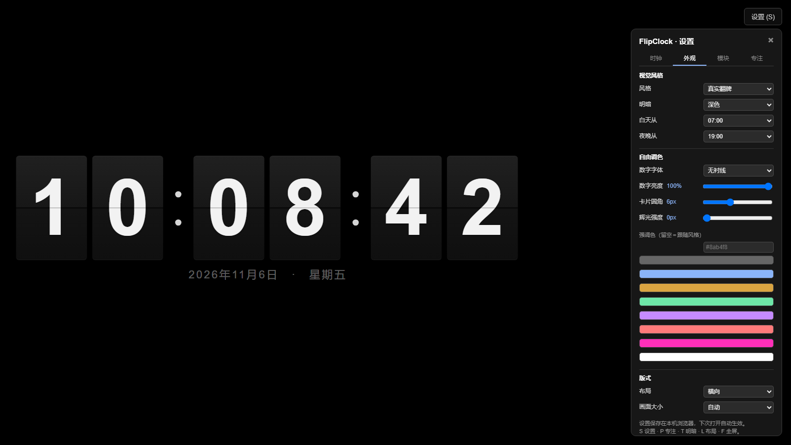
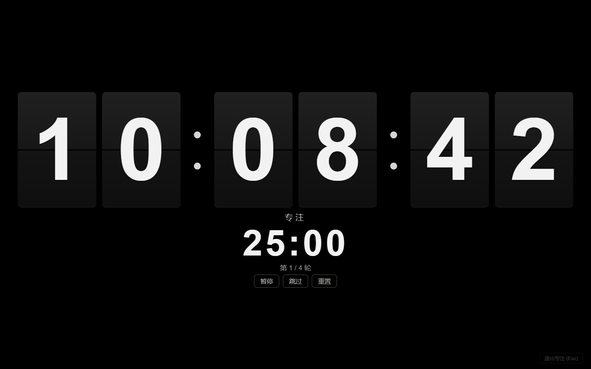
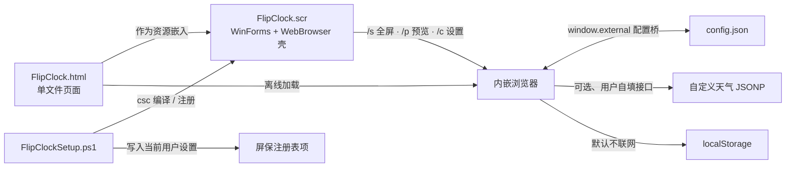

  

<h1 align="center">FlipClock</h1>

  <strong>一个完全离线的翻页时钟</strong> 
  单文件网页 · 可一键装成 Windows 屏保 · 不联网、不装依赖

  <a href="README.en.md">English</a> · <b>简体中文</b> &nbsp;|&nbsp;
  <a href="#效果预览">效果预览</a> ·
  <a href="#快速开始">快速开始</a> ·
  <a href="#安装为屏保">安装为屏保</a> ·
  <a href="https://github.com/xyzOvO/FlipClock/issues">问题反馈</a>

---

> 这是大学时候最喜欢用的屏保，由于系统更新后续只能黑屏从而放弃使用，AI时代来临通过AI重译，有需要的同学可参考。

<table>
<tr><td valign="top">

- [效果预览](#效果预览)
- [快速开始](#快速开始)
- [功能一览](#功能一览)
- [设置与操作](#设置与操作)
- [模块详解](#模块详解)
- [安装为屏保](#安装为屏保)
- [它是怎么来的](#它是怎么来的)

</td><td valign="top">

- [工作方式](#工作方式)
- [文件说明](#文件说明)
- [兼容与环境](#兼容与环境)
- [常见问题](#常见问题)
- [已知边界](#已知边界)
- [声明](#声明)

</td></tr>
</table>

---

## 效果预览

默认打开就是一块黑底白字的翻页钟，每一位数字都是独立的翻牌卡片。

默认深色真实翻牌 · 24 小时制 · 日期与星期

下面四张分别是「开满模块」「换主题」「改设置」「进入专注」，都是同一份 HTML 的实际运行画面：

| 赛博风格 + 全部模块 | 浅色极简 + 农历 / 倒数日 |
| :---: | :---: |
|  |  |
| 世界时钟、农历节日、倒数日、时间进度、天气可同时开启 | 四套风格各配深浅两套配色，也可按时间自动切换 |

| 设置面板 | 番茄钟专注模式 |
| :---: | :---: |
|  |  |
| 四个标签页，改动即时生效并自动保存在本机 | 开启后只留时钟与倒计时，其余模块全部隐藏 |

## 快速开始

**只想先看一眼？** 双击 `FlipClock.html` 就够了，不会改动系统任何东西。

| | 方式一：当网页用 | 方式二：装成 Windows 屏保 |
| --- | --- | --- |
| 做什么 | 双击 `FlipClock.html`，按 `F11`（或 `F`）全屏 | 双击 `安装屏保.exe`，没有 EXE 时用 `安装屏保.bat` |
| 前置条件 | 任意现代浏览器 | Windows + 系统自带 .NET Framework 4.x |
| 系统改动 | 无 | 见[安装为屏保](#安装为屏保)，需一次 UAC 授权 |
| 空闲自动启动 | 不支持 | 支持，默认空闲 10 分钟 |
| 设置保存在 | 浏览器 `localStorage` | `%LOCALAPPDATA%\FlipClock\config.json` |

按 `S` 打开设置，改完自动保存，下次打开照旧。想让它一直亮着，把系统电源设置里的「关闭显示器」时间调长即可；支持的浏览器还会自动申请 Wake Lock 防止息屏。

装成屏保后，可在「屏幕保护程序设置」里预览、改等待时间；点「设置」会打开一个已展开设置面板的窗口，改动自动保存并立即生效。

## 功能一览

| 分类 | 能做什么 |
| --- | --- |
| 显示 | 12 / 24 小时制、可选显示秒、中文日期与星期、倒数日提醒条 |
| 翻页 | 经典上下分体翻页（split-flap），带光影与进位逐位阶梯翻落；**速度可调**、可减弱或整体关闭 |
| 报时 | 整点 / 半点提示音可选，运行时合成极短 WAV，不附带任何音频文件 |
| 外观 | 四套风格（真实翻牌 / 复古机械 / 极简现代 / 赛博科技）× 深色 / 浅色 / 按时间自动切换；强调色、字体、亮度、圆角、辉光、画面大小均可调 |
| 布局 | 横向 / 纵向 / 紧凑 / 宽屏四种，随视口等比缩放，切换模块时卡片尺寸不跳变 |
| 世界时钟 | 内置 17 个城市任选最多 6 个，显示当地时间、`UTC±` 偏移，自动换算夏令时，可放左下 / 右下 / 顶部 |
| 历法 | 本地农历（干支、生肖）、公历与农历节日、除夕；1900–2100 离线换算 |
| 其它模块 | 时间进度（日 / 时 / 分 / 年）、天气、倒数日，全部可独立开关 |
| 专注 | 番茄钟（自定义工作 / 短休 / 长休 / 轮数），沉浸模式只留时钟与倒计时 |
| 屏保体验 | 多显示器全屏、隐藏指针、按键 / 点击 / 移动鼠标即退出、小窗预览、点「设置」改选项 |
| 隐私 | 默认运行时不访问网络、不上传数据、不收集信息 |
| 工程 | 单文件网页、纯 ES5、无 CSS 变量、零外部依赖、无构建步骤；壳子只用系统自带 .NET Framework |

## 设置与操作

### 快捷键

| 按键 | 效果 |
| --- | --- |
| `S` | 打开 / 关闭设置面板 |
| `P` | 开 / 关番茄钟专注模式 |
| `空格` | 专注模式下暂停 / 继续 |
| `T` | 深色 / 浅色快速切换 |
| `L` | 循环切换横向 → 纵向 → 紧凑 → 宽屏 |
| `F` / `F11` | 进入全屏 |
| `Esc` | 退出专注模式，或关闭设置面板 |
| 全屏时按键 / 点击 / 移动鼠标 | 退出全屏（对应屏保被唤醒） |
| 鼠标静止 3 秒 | 隐藏指针与右上角按钮，动一下即恢复 |

焦点在下拉框、滑块、输入框里时快捷键不会误触发。装成 `.scr` 后网页快捷键一律停用：设置窗口里面板常开、没有「×」，退出屏保由壳子负责；设置窗口里的项目地址交给系统默认浏览器打开，不会把页面导航走。

### 设置面板的四个标签页

改动即时保存并立即生效。

- **时钟** — 时间制式、显示秒、显示日期；翻页动画开关、速度（0.50× – 2.00×）、减少动态效果；报时（关闭 / 整点 / 半点 / 两者）与试听。
- **外观** — 风格、明暗（深色 / 浅色 / 跟随时间自动）、白天与夜晚切换时刻、数字字体、亮度、卡片圆角、辉光、强调色、布局、画面大小。
- **模块** — 世界时钟开关 / 位置 / 秒 / 夏令时 / 城市多选；倒数日名称与日期；农历、节日；时间进度；天气的城市 / 概况 / 图标 / 自定义接口。
- **专注** — 专注模式开关、工作 / 短休 / 长休分钟数、长休间隔轮数、自动进入下一阶段、阶段提示音、重置当前番茄钟。

普通浏览器里设置存在 `localStorage`；被 `.scr` 壳子加载时改写入 `%LOCALAPPDATA%\FlipClock\config.json`，设置窗口与屏保窗口读同一份值，也不受 IE 对本地页面 `localStorage` 的限制。旧版键名会自动迁移一次；所有配置都过白名单校验，坏数据不会把画面弄花。

### 视觉风格与布局

| 风格 | 观感 |
| --- | --- |
| 真实翻牌 | 默认。深色卡片、上下渐变、中缝与翻页光影，最接近机械翻牌牌面 |
| 复古机械 | 暖棕 / 米黄、衬线数字、铜色描边，像老式车站翻牌钟 |
| 极简现代 | 纯色块、无渐变无阴影、细中缝，留白更多 |
| 赛博科技 | 青色数字、品红强调、等宽字体、辉光与扫描线 |

四套风格都支持深浅两套配色，「跟随时间自动」按设定的白天、夜晚时刻切换，屏保长时间挂着也不会一直亮或一直暗；按 `T` 可随时手动覆盖。按 `L` 循环四种布局：横向一行、纵向堆叠、紧凑小卡、宽屏大卡。缩放基准始终取「该布局全部模块展开」的尺寸，所以开关模块、切换制式时卡片大小不会跳变。

## 模块详解

**倒数日**显示在时钟正下方、日期行再下面，跟着整个钟面一起等比缩放。文案按日期自动切换为「距离 X 还有 N 天」「今天就是 X」「X 已过 N 天」；日期按字符串解析，不受时区与夏令时影响，填错或留空时自动隐藏。名称按纯文本处理，最多 24 字。

**世界时钟**：内置 17 个城市，最多勾选 6 个，默认左下角，也可放右下角或顶部横条。显示当地时间、`UTC±` 偏移，可选显示秒。「自动夏令时」按美国 / 欧洲 / 澳大利亚的常用规则在本地换算，不依赖 `Intl`（IE11 内核没有）；规则变动时可关掉改用固定偏移。窄屏自动收窄，小窗预览里自动隐藏侧栏。

**农历与节日**：完全离线换算 1900–2100 的农历月日，附带干支年与生肖；公历固定节日、农历节日（春节、元宵、端午、七夕、中秋、重阳、腊八等）与除夕自动标注。超出历表范围自动隐藏。

**时间进度**：右下角显示「今日已过」百分比，以及日 / 时 / 分 / 年四条细进度条，每秒更新。

**天气**：默认**完全离线**，城市、概况、图标由自己填写，页面不发任何请求。需要自动数据时，在「数据接口」填一个自定义 JSONP 地址（返回 `{city, text, icon}`）才会定时拉取；请求失败自动保留手填内容。项目不内置任何第三方天气服务地址、账号或密钥。

**番茄钟**：默认 25 分钟专注 / 5 分钟短休 / 15 分钟长休 / 每 4 轮长休，全部可改。开启后进入沉浸模式，日期、农历、倒数日、世界时钟、进度、天气、提示、设置按钮全部隐藏；支持暂停 / 继续、跳过、重置，阶段切换可用提示音。倒计时按**绝对结束时间戳**计算，切后台或刷新页面都不会跑偏。

**走时与校准**：每秒用 `new Date()` 取当前时分秒，动画只负责把字符变化演出来，绝不靠播放次数累计时间；秒位每秒更新，时 / 分位只在进位时重绘，长时间运行不会漂移。后台节流或系统睡眠醒来，会检测时间跳变、跳过补播动画直接按真实时间重绘；`visibilitychange`、`pageshow`、`focus` 也会触发校时，Wake Lock 在切回前台后重新申请。

## 安装为屏保

把仓库里的文件放在**同一个文件夹**，双击 `安装屏保.exe`（或 `安装屏保.bat`），弹一次 UAC 后自动完成：

1. 找到系统自带的 .NET Framework 编译器 `csc.exe`；
2. 把 `FlipClock.html` 作为资源嵌入 `FlipClockShell.cs`，编译成自包含的 `FlipClock.scr`；
3. 复制到 `C:\Windows\System32`，让「屏幕保护程序设置」下拉里能选到 `FlipClock`；
4. 设为当前屏保，空闲 10 分钟启动。

也就是说，**C# 编译发生在你双击安装时，由本机完成**；仓库里的 EXE 只是把源码送进去的自解压载体，不含预编译的 `.scr`。

<b>展开查看：安装会改动系统的每一项</b>

全部集中在 `FlipClockSetup.ps1`，可逐行核对：

| 位置 | 内容 |
| --- | --- |
| `C:\Windows\System32\FlipClock.scr` | 新增一个文件 |
| 当前用户 `Control Panel\Desktop` | `SCRNSAVE.EXE`、`ScreenSaveActive=1`、`ScreenSaverIsSecure=0`、`ScreenSaveTimeOut=600` |
| 当前用户 `FEATURE_BROWSER_EMULATION` | 仅对进程名 `FlipClock.scr` 设 `11001`（让内嵌浏览器走 IE11 文档模式） |
| `%LOCALAPPDATA%\FlipClock\config.json` | 运行期生成的个人配置 |
| `%TEMP%\FlipClock.html`、`%WINDIR%\Temp\FlipClockBuild` | 网页缓存与编译中间目录，编译完即清理 |

**卸载**：双击 `卸载屏保.exe`（或 `卸载屏保.bat`），删除 `System32` 里的 `.scr`、清掉本项目写入的屏保与仿真注册项、把屏保设为「关闭」并清理临时缓存。个人配置目录会保留，详见[已知边界](#已知边界)。

## 它是怎么来的

以前喜欢的那款屏保，本体是一个很薄的 Windows 窗体壳子，钟面和翻页动画其实来自一个在线网页。后来那个地址不再提供页面，壳子加载不到内容，就只剩一片黑屏。系统更新只是表象，根子在「运行时依赖一个已经失效的网址」。

这里说的 **「AI 重译」**，指的是借助 AI 把「机械翻页牌时钟」这个想法**从零重新实现一遍**：HTML / CSS / JavaScript、C# 壳子、PowerShell 安装脚本全部重新编写，没有翻译、改写或复制原程序的任何一行代码，也没有使用它的图片、字体或二进制文件。

结果是一份**不联网、不装依赖、不依赖任何远程地址**的实现：网页可以单独打开，也可以被编译进一个自包含的 `.scr`。

## 工作方式

- **页面**只负责显示与交互，纯 ES5、不用框架、不用 CSS 变量，因此在 IE11 内核的 `WebBrowser` 里也能跑。
- **首行 MOTW 注释不能删**：没有它，IE 会封锁本地 `file://` 页面的脚本，屏保里的设置面板会点不动。万一被删，壳子写缓存时会自动补回。
- **壳子**按 Windows 标准屏保协议处理 `/s`（每块屏幕一个无边框窗口）、`/p`（嵌进系统设置里的小显示器）、`/c`（设置窗口）；页面加载完成后调用 `ApplyShellMode()` 切换形态。启动即声明 DPI 感知。
- **缓存比对**是逐字节的：重新安装新版本时 `%TEMP%` 里的旧网页会被自动替换，不需要手动清理。
- **安装脚本**是唯一会改动系统的文件，安装 / 卸载共用；提权后仍写入登录用户的配置，不会写到管理员账户上。自解压 EXE 是 32 位，脚本提权时优先调用真正的 64 位 PowerShell，避免 `.scr` 被 WOW64 重定向写进 `SysWOW64`；安装完还会复核文件位置与每一项注册表写入结果。

## 文件说明

| 文件 | 作用 |
| --- | --- |
| `FlipClock.html` | 成品网页，单文件、零依赖，可直接双击 |
| `FlipClockShell.cs` | 极简 WinForms + WebBrowser 壳，含配置桥与屏保退出逻辑 |
| `FlipClockSetup.ps1` | 安装 / 卸载逻辑，唯一会改动系统的文件 |
| `安装屏保.bat` / `卸载屏保.bat` | 调用上面脚本的命令行入口 |
| `安装屏保.exe` / `卸载屏保.exe` | 上二者的自解压打包版，双击即用 |
| `README.md` / `README.en.md` | 中文 / 英文说明 |
| `docs/` | 封面插图、功能截图，以及 1280×640 的分享封面用图 `social-preview.jpg` |

两个 EXE 由 Windows 自带的 `iexpress.exe` 打包，内部只含本仓库的脚本与网页（文件名全为 ASCII），不含任何第三方程序；没有数字签名，首次运行会有系统提示，安装时靠内部脚本弹一次 UAC。

## 兼容与环境

| | |
| --- | --- |
| 操作系统 | Windows（屏保部分）；网页部分任意系统均可 |
| 编译 / 安装 | 系统自带 .NET Framework 4.x 的 `csc.exe`，不需要 Visual Studio、SDK、NuGet 或联网 |
| 网页浏览器 | 现代浏览器完整支持；IE11 内核下也能正常显示与设置（2D 变换模拟翻页，不依赖 CSS 3D、Web Audio 或 `Intl`） |
| 显示器 | 屏保模式按 `Screen.AllScreens` 逐屏铺满；网页模式跟随窗口大小自动缩放 |
| 权限 | 安装需要一次管理员授权（写入 `System32`）；日常使用与卸载不需要额外依赖 |

窄到手机竖屏也能完整居中，不会横向裁切：

提示音是运行时合成的一段 WAV data URI，不引用外部文件；部分浏览器有自动播放限制，可先在设置里点「试听提示音」完成解锁。

## 常见问题

<b>装完还是黑屏 / 设置点不动？</b>

确认 `.NET Framework 4.x` 已启用、`FlipClock.html` 首行 MOTW 注释没被删，然后重新运行一次 `安装屏保.exe`。屏保里本来就会隐藏底部提示与右上角按钮，这是正常形态。

<b>我改了 FlipClock.html，屏保里没变化？</b>

`.scr` 里嵌的是**安装那一刻**的网页副本。改完网页后重新运行一次安装程序，新的页面会被编进去；缓存会逐字节比对后自动替换。

<b>设置改了不生效 / 下次又变回去？</b>

设置窗口和屏保共用 `%LOCALAPPDATA%\FlipClock\config.json`；纯网页模式用浏览器的 `localStorage`。两者是独立存储，正常现象。

<b>世界时钟的时间对不上？</b>

先确认城市选对了；欧美澳城市默认自动换算夏令时，若当地规则有变可关掉「自动夏令时」改用标准偏移。本程序按内置规则本地换算，不是实时时区数据库。

<b>天气为什么不会自己更新？</b>

默认纯离线、不发请求，需要自己在设置里填城市与概况。想自动更新，就填一个支持 `callback` 的 JSONP 接口地址；项目不内置任何天气服务。

<b>农历显示的年份范围？</b>

1900–2100，超出后该行自动隐藏。节日表覆盖常见公历节日与主要农历节日，不含调休、法定假期安排。

<b>专注模式怎么退出？</b>

按 `Esc`、按 `P`，或点右下角很淡的「退出专注」。开启专注后其它模块会被隐藏，关掉即恢复。

<b>为什么弹 UAC？会不会改到别的账户？</b>

写入 `System32` 需要管理员权限；脚本提权后仍按传入的登录用户 SID 写注册表，不会写到管理员账户的配置里。

<b>不想要了怎么彻底还原？</b>

运行 `卸载屏保.exe`，再到「屏幕保护程序设置」里选回原来的屏保或「无」即可。等待时间等显示选项不会被自动改回，见下节。

<b>杀毒软件报未知发布者？</b>

EXE 没有代码签名（个人项目），属于常见提示。所有内容都在 `FlipClockSetup.ps1` 里明文可读，可以先逐行看过再运行；也可以直接用 `.bat` 入口。

## 已知边界

- 卸载后 `ScreenSaveTimeOut`（等待时间）与 `ScreenSaverIsSecure`（恢复时是否要求登录）保持安装时设的值，可在系统设置里手动改回；`%LOCALAPPDATA%\FlipClock\config.json` 也会保留，需要彻底清理可自行删除该目录。
- 若之前装过本项目的其他命名版本，旧名的 `.scr`、旧注册项与旧配置目录**不会自动清理**——刻意不做通配删除，以免误删系统目录里的其他屏保。
- 网页版不会在系统空闲时自动启动，它是「手动 F11 的屏保观感」；真正的空闲启动需要安装 `.scr`。
- 屏保内的设置窗口关闭后返回系统设置对话框，不会自动重新预览，属于 Windows 的既有行为。
- 天气模块默认离线；自定义 JSONP 接口在 IE11 `WebBrowser` 的 `file://` 环境下可能受系统跨域策略限制，失败会静默保留手填内容。夏令时与农历都按内置规则 / 历表换算，不随外部数据库实时更新。
- 番茄钟状态随配置一起保存，点「恢复默认」会重置当前轮次；提示音受浏览器自动播放策略影响。
- 本项目未执行过真机端到端安装验证：编译、写注册表与安装到系统都由使用者双击时完成，源码侧只做过静态与无头浏览器验证。

## 声明

- 本项目**程序本体**（HTML / CSS / JavaScript、C#、PowerShell）均为**从零独立编写**，是对「机械翻页牌时钟」这一通用形式的重新实现；不含任何第三方屏保程序的源代码、脚本、字体或二进制文件，不含任何反编译产物，也不含任何第三方商标或品牌字样。
- `docs/` 下的图片仅用于仓库展示：功能截图为本项目实际运行画面；封面插图与分享用图由仓库所有者提供，不参与程序构建，插画角色形象的权利归原权利人所有。
- 内置的 1900–2100 农历历表为**公开历法事实数据常量**，换算算法自行实现；城市时区与夏令时规则同样按公开通用规则本地实现，不调用任何在线时区 / 天气服务，也不内置第三方服务地址、账号或密钥。
- 翻页时钟的外观构思来自上世纪车站、机场常见的机械翻页显示牌（split-flap display），属于通用设计思想与功能，不涉及对任何特定产品的复制。
- 本项目与任何同类商业屏保及其开发者、权利人均无关联，未获其授权或认可，也不代表其立场。项目名 `FlipClock` 为通用描述性名称，与任何同名项目无关。
- 运行时默认不访问网络、不上传数据、不收集信息（设置面板里的项目地址、天气的自定义接口都只在用户主动点击或主动填写后才会由浏览器发起访问）。
- 仓库未附加开源许可证，仅供个人学习、自用与参考，保留所有权利；如需其他使用方式欢迎提 Issue 联系。若相关权利人认为内容不妥，也请通过 Issue 告知，我会及时处理。

---

xyzOvO · 2026 · <a href="README.en.md">English version</a>

