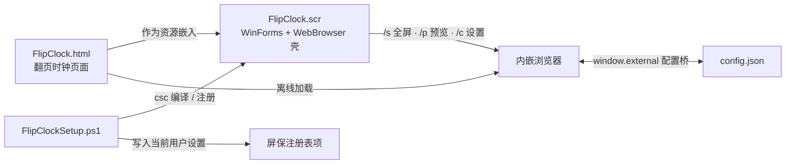

# FlipClock

> 这是大学时候最喜欢用的屏保，由于系统更新后续只能黑屏从而放弃使用，AI时代来临通过AI重译，有需要的同学可参考。

一个完全离线的本地翻页时钟。既是**双击就能看的单文件网页**，也能**装进 Windows 的屏幕保护程序列表**，黑底白字、整秒翻页、多显示器全屏。

- [它是怎么来的](#它是怎么来的)
- [特性](#特性)
- [快速开始](#快速开始)
- [操作与快捷键](#操作与快捷键)
- [设置项](#设置项)
- [工作方式](#工作方式)
- [文件说明](#文件说明)
- [兼容与环境](#兼容与环境)
- [常见问题](#常见问题)
- [已知边界](#已知边界)
- [声明](#声明)

## 它是怎么来的

以前喜欢的那款屏保，本体是一个很薄的 Windows 窗体壳子，钟面和翻页动画其实来自一个在线网页。后来那个地址不再提供页面，壳子加载不到内容，就只剩一片黑屏。系统更新只是表象，根子在「运行时依赖一个已经失效的网址」。

这里说的 **「AI 重译」**，指的是借助 AI 把「机械翻页牌时钟」这个想法**从零重新实现一遍**：HTML / CSS / JavaScript、C# 壳子、PowerShell 安装脚本全部重新编写，没有翻译、改写或复制原程序的任何一行代码，也没有使用它的图片、字体或二进制文件。

结果是一份**不联网、不装依赖、不依赖任何远程地址**的实现：网页可以单独打开，也可以被编译进一个自包含的 `.scr`。

## 特性

| | |
| --- | --- |
| 显示 | 12 / 24 小时制、可选显示秒、中文日期与星期 |
| 动画 | 经典上下分体翻页（split-flap），带光影与进位时逐位阶梯翻落，可整体关闭 |
| 外观 | 数字亮度、画面大小（小 / 自动 / 大）、纯黑或深灰背景 |
| 屏保体验 | 多显示器全屏、隐藏鼠标指针、按键 / 点击 / 移动鼠标即退出、小窗预览、点「设置」改选项 |
| 设置 | 改动即时保存，设置窗口与屏保窗口共用同一份配置；支持「恢复默认」 |
| 工程 | 单文件网页、纯 ES5、无 CSS 变量、零外部依赖、无构建步骤；壳子只用系统自带 .NET Framework |
| 隐私 | 运行时不访问网络、不上传任何数据、不收集任何信息 |

## 快速开始

### 方式一：只当网页用

双击 `FlipClock.html`，按 **F11**（或设置面板里的「全屏显示」）就是一块黑底翻页时钟。按 **S** 打开设置，改完自动保存在本机浏览器，下次打开照旧。

这条路径不改动系统的任何东西。想让它一直亮着，把系统电源设置里的「关闭显示器」时间调长即可；支持的浏览器还会自动请求 Wake Lock 防止息屏。

### 方式二：装成 Windows 屏保

把仓库里的文件放在**同一个文件夹**，双击 `安装屏保.exe`（没有 EXE 时用 `安装屏保.bat`），弹一次 UAC 后自动完成：

1. 找到系统自带的 .NET Framework 编译器 `csc.exe`
2. 把 `FlipClock.html` 作为资源嵌入 `FlipClockShell.cs`，编译成自包含的 `FlipClock.scr`
3. 复制到 `C:\Windows\System32`，让「屏幕保护程序设置」下拉里能选到 `FlipClock`
4. 设为当前屏保，空闲 10 分钟启动

装好后可以在系统设置里预览、改等待时间，点「设置」会弹出一个已经展开设置面板的窗口，改动自动保存并立即生效。

**安装会改动的东西**（全部集中在 `FlipClockSetup.ps1`，可逐行核对）：

| 位置 | 内容 |
| --- | --- |
| `C:\Windows\System32\FlipClock.scr` | 新增一个文件 |
| 当前登录用户的 `Control Panel\Desktop` | `SCRNSAVE.EXE`、`ScreenSaveActive=1`、`ScreenSaverIsSecure=0`、`ScreenSaveTimeOut=600` |
| 当前登录用户的 `FEATURE_BROWSER_EMULATION` | 仅对进程名 `FlipClock.scr` 设 `11001`（让内嵌浏览器走 IE11 文档模式） |
| `%LOCALAPPDATA%\FlipClock\config.json` | 运行期生成的个人配置 |
| `%TEMP%\FlipClock.html`、`%WINDIR%\Temp\FlipClockBuild` | 网页缓存与编译中间目录，编译完即清理 |

**卸载**：双击 `卸载屏保.exe`（或 `卸载屏保.bat`），会删除 `System32` 里的 `.scr`、清掉本项目写入的屏保与仿真注册项、把屏保设为「关闭」，并清理临时缓存。个人配置目录会保留，详见[已知边界](#已知边界)。

## 操作与快捷键

| 操作 | 效果 |
| --- | --- |
| `S` | 打开 / 关闭设置面板 |
| `F` 或 `F11` | 进入全屏 |
| `Esc` | 关闭设置面板（退出全屏由浏览器接管） |
| 全屏时按键 / 点击 / 移动鼠标 | 退出全屏（对应屏保被唤醒；可在设置里关闭） |
| 鼠标静止 3 秒 | 隐藏指针与右上角按钮，动一下即恢复 |
| 右上角「设置」/「×」 | 打开 / 关闭设置面板 |

焦点在下拉框、滑块等控件上时，`S` / `F` 不会误触发。

## 设置项

| 项目 | 可选值 |
| --- | --- |
| 时间制式 | 24 小时 / 12 小时（12 小时制首位自动留白并显示 AM / PM） |
| 显示秒 | 开 / 关 |
| 显示日期 | 开 / 关 |
| 翻页动画 | 开 / 关 |
| 全屏后碰一下退出 | 开 / 关 |
| 数字亮度 | 50% – 100% |
| 画面大小 | 小 / 自动 / 大 |
| 背景 | 纯黑 / 深灰 |
| 恢复默认 | 一键还原全部选项 |

普通浏览器里设置存在 `localStorage`；被 `.scr` 壳子加载时，改由壳子写入 `%LOCALAPPDATA%\FlipClock\config.json`，这样设置窗口和屏保窗口读到的是同一份值，也不再受 IE 对本地页面 `localStorage` 的限制。旧版键名会自动迁移一次，不会丢设置。

## 工作方式

- **页面**只负责显示与交互，纯 ES5，不用框架、不用 CSS 变量，因此在 IE11 内核的 `WebBrowser` 里也能跑。
- **首行的 MOTW 注释不能删**：没有它，IE 会封锁本地 `file://` 页面的脚本，屏保里的设置面板会点不动。万一被删了，壳子写缓存时会自动补回。
- **壳子**按 Windows 标准屏保协议处理 `/s`（每块屏幕一个无边框窗口）、`/p`（嵌进系统设置里的小显示器）、`/c`（设置窗口）；页面加载完成后调用 `ApplyShellMode()` 切换对应形态。
- **缓存比对**是逐字节的：重新安装新版本时，`%TEMP%` 里的旧网页会被自动替换，不需要手动清理。
- **安装脚本**是唯一会改动系统的文件，安装 / 卸载两种模式共用；提权后仍写入登录用户的配置，不会写到管理员账户上。

## 文件说明

| 文件 | 作用 |
| --- | --- |
| `FlipClock.html` | 成品网页，单文件、零依赖，可直接双击 |
| `FlipClockShell.cs` | 极简 WinForms + WebBrowser 壳，含配置桥与屏保退出逻辑 |
| `FlipClockSetup.ps1` | 安装 / 卸载逻辑，唯一会改动系统的文件 |
| `安装屏保.bat` / `卸载屏保.bat` | 调用上面脚本的命令行入口 |
| `安装屏保.exe` / `卸载屏保.exe` | 上二者的自解压打包版，双击即用，无需记命令 |
| `README.md` | 本说明 |

两个 EXE 由 Windows 自带的 `iexpress.exe` 打包，内部只含本仓库的脚本与网页（文件名全为 ASCII），不含任何第三方程序；没有数字签名，首次运行会有系统提示，安装时靠内部脚本弹一次 UAC。

## 兼容与环境

| | |
| --- | --- |
| 操作系统 | Windows（屏保部分）；网页部分任意系统均可 |
| 编译 / 安装 | 系统自带 .NET Framework 4.x 的 `csc.exe`，不需要 Visual Studio、SDK、NuGet 或联网 |
| 网页浏览器 | 现代浏览器完整支持；IE11 内核下也能正常显示与设置（2D 变换模拟翻页，不依赖 CSS 3D） |
| 显示器 | 屏保模式按 `Screen.AllScreens` 逐屏铺满；网页模式跟随窗口大小自动缩放 |
| 权限 | 安装需要一次管理员授权（写入 `System32`）；日常使用与卸载不需要额外依赖 |

## 常见问题

**装完还是黑屏 / 设置点不动？**
确认 `.NET Framework 4.x` 已启用、`FlipClock.html` 首行 MOTW 注释没被删，然后重新运行一次 `安装屏保.exe`。屏保里本来就会隐藏底部提示与右上角按钮，这是正常形态。

**我改了 `FlipClock.html`，屏保里没变化？**
`.scr` 里嵌的是**安装那一刻**的网页副本。改完网页后重新运行一次安装程序，新的页面会被编进去；缓存会逐字节比对后自动替换。

**设置改了不生效 / 下次又变回去？**
设置窗口和屏保共用 `%LOCALAPPDATA%\FlipClock\config.json`；纯网页模式则用浏览器的 `localStorage`。两者是独立存储，正常现象。

**为什么弹 UAC？会不会改到别的账户？**
写入 `System32` 需要管理员权限；脚本提权后仍按传入的登录用户 SID 写注册表，不会写到管理员账户的配置里。

**不想要了怎么彻底还原？**
运行 `卸载屏保.exe`，再到「屏幕保护程序设置」里选回原来的屏保或「无」即可。等待时间等显示选项不会被自动改回，见下节。

**杀毒软件报未知发布者？**
EXE 没有代码签名（个人项目），属于常见提示。所有内容都在 `FlipClockSetup.ps1` 里明文可读，可以先逐行看过再运行；也可以直接用 `.bat` 入口。

## 已知边界

- 卸载后，`ScreenSaveTimeOut`（等待时间）与 `ScreenSaverIsSecure`（恢复时是否要求登录）保持安装时设的值，可在系统设置里手动改回；`%LOCALAPPDATA%\FlipClock\config.json` 也会保留，需要彻底清理可自行删除该目录。
- 若之前装过本项目的其他命名版本，旧名的 `.scr`、旧注册项与旧配置目录**不会自动清理**——刻意不做通配删除，以免误删系统目录里的其他屏保。
- 网页版不会在系统空闲时自动启动，它是「手动 F11 的屏保观感」；真正的空闲启动需要安装 `.scr`。
- 屏保内的设置窗口关闭后返回系统设置对话框，不会自动重新预览，属于 Windows 的既有行为。
- 本项目未执行过真机端到端安装验证：编译、写注册表与安装到系统都由使用者双击时完成，源码侧只做过静态与无头浏览器验证。

## 声明

- 本项目全部代码（HTML / CSS / JavaScript、C#、PowerShell）均为**从零独立编写**，是对「机械翻页牌时钟」这一通用形式的重新实现。仓库内**不含任何第三方屏保程序的源代码、脚本、图片、字体或二进制文件**，不含任何反编译产物，也不含任何第三方商标或品牌字样。
- 翻页时钟的外观构思来自上世纪车站、机场常见的机械翻页显示牌（split-flap display），属于通用设计思想与功能，不涉及对任何特定产品的复制。
- 本项目与任何同类商业屏保及其开发者、权利人均无关联，未获其授权或认可，也不代表其立场。项目名 `FlipClock` 为通用描述性名称，与任何同名项目无关。
- 运行时不访问网络、不上传数据、不收集信息。
- 仓库未附加开源许可证，仅供个人学习、自用与参考，保留所有权利；如需其他使用方式欢迎提 Issue 联系。若相关权利人认为内容不妥，也请通过 Issue 告知，我会及时处理。

---

xyzOvO · 2026
